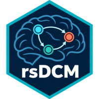

# rsDCM: Robust and Sparse Dynamic Causal Modelling for Functional MRI

<!-- badges: start -->
[](https://CRAN.R-project.org/package=rsDCM)
[](https://github.com/Kay202/rsDCM/actions/workflows/R-CMD-check.yaml)
[](https://www.codefactor.io/repository/github/Kay202/rsDCM)
[](https://cran.r-project.org/package=rsDCM)
<!-- badges: end -->

`rsDCM` provides robust and sparse group inference for Dynamic Causal
Modelling (DCM) and an R port of deterministic single-state fMRI DCM and
Parametric Empirical Bayes routines from SPM25.

The group method combines:

- a Student-t likelihood after block-covariance pre-whitening
- a Gaussian-spike and nonlocal product-moment (pMOM)-slab prior
- multistart generalized EM with conditional maximization
- parallel-tempering integration of posterior inclusion probabilities
- conditional Laplace standard deviations for group coefficients

Student-t weights describe atypical residual coordinates in the selected
whitening basis. They should not be interpreted as invariant whole-subject
weights.

## Installation

Install the released version from CRAN:

```r
install.packages("rsDCM")
```

Install the development version from GitHub:

```r
# install.packages("remotes")
remotes::install_github("Kay202/rsDCM")
```

## Quick start: Robust and sparse group inference

```r
library(rsDCM)
set.seed(1)
N <- 12L
p <- 3L
X_G <- matrix(1, N, 1, dimnames = list(NULL, "intercept"))
eta <- matrix(rnorm(N * p, sd = 0.25), N, p)
eta[, 1] <- eta[, 1] + 0.7
colnames(eta) <- paste0("P", seq_len(p))
Cp <- replicate(N, diag(0.1, p), simplify = FALSE)
V <- lapply(seq_len(p), function(j) {
  z <- matrix(0, p, p)
  z[j, j] <- 1
  z
})

fit <- rsdcm(
  eta, Cp, X_G, V, n_starts = 1L, max_iter = 100L,
  pip_mcmc_iter = 1000L, pip_mcmc_burn = 400L,
  pip_mcmc_thin = 5L, pip_mcmc_chains = 2L,
  pip_mcmc_temperatures = 4L, verbose = FALSE
)
cbind(fit$beta_mat, PIP = fit$inclusion[, 1])
```

## Single-subject DCM

```r
data(toy_dcm)
fit_dcm <- dcm_estimate(toy_dcm)
round(fit_dcm$Ep$A, 3)
fit_dcm$F
```

See `vignette("introduction", package = "rsDCM")` for further details.

## Source organization

- `R/rsDCM.R` contains the novel robust and sparse group method.
- `R/DCM.R` contains the SPM25-derived MATLAB ports.
- `src/` contains the registered C++ parallel-tempering sampler.

## License and acknowledgment

The package is licensed under GPL-2. The SPM25-derived functions remain
subject to their original copyright and license. See `LICENSE.note` for the
list of ported routines.

## References

Arhin, G. and Sanyal, N. (2026). Robust and Sparse Group Dynamic Causal
Modeling via Student-t Parametric Empirical Bayes and Nonlocal Priors.
[doi:10.48550/arXiv.2609.06379](https://doi.org/10.48550/arXiv.2609.06379)

Friston, K. J., Harrison, L., and Penny, W. (2003). Dynamic causal modelling.
*NeuroImage*, 19(4), 1273--1302.
[doi:10.1016/S1053-8119(03)00202-7](https://doi.org/10.1016/S1053-8119(03)00202-7)
